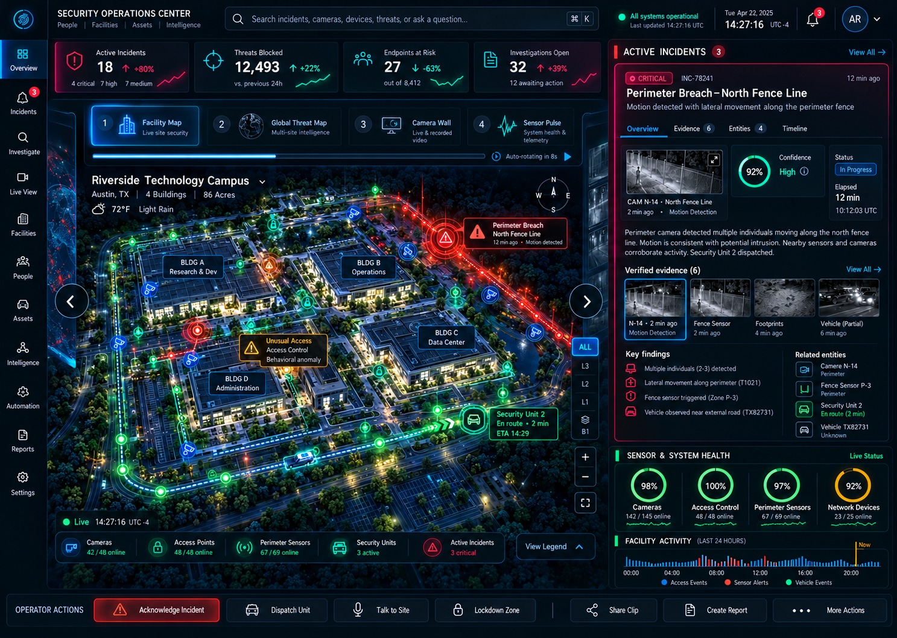
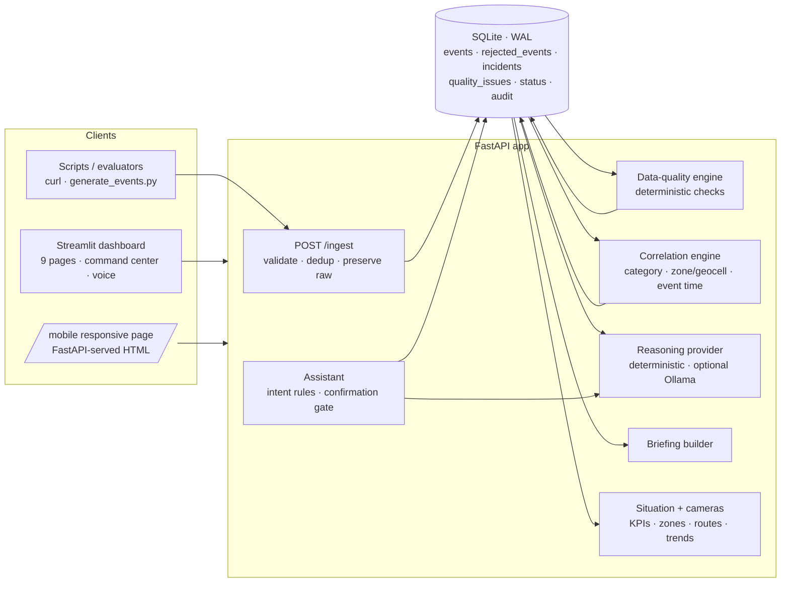

# Zenith AI-Native SecOps Platform (MVP)

A local-first security-operations MVP built with **FastAPI + Streamlit + SQLite**.
It ingests multi-source security events, validates them without discarding evidence,
runs deterministic data-quality checks, correlates related events into explainable
incidents, and produces an evidence-backed operational briefing. It runs offline on a
laptop: **no external AI service, API key, model download or GPU is required**.

> "AI-native" describes the product direction and the agent-friendly API/dashboard
> architecture. The MVP's reasoning is deliberately deterministic and auditable, not
> a hosted LLM. Every number, incident and recommendation can be traced to stored rows.

---

## Demo video

**Demo video:** [`../demo video/zenith-demo.webm`](../demo%20video/zenith-demo.webm) — 3 min 54 s
recording of the running dashboard (page content only, no narration).

---

## Verified status

All results below were produced by the commands shown on a Windows 11 laptop (Python 3.12, no GPU) on 2026-10-25; they are measured, not estimated. Latest full run: `.erify_all.ps1` → `VERIFY_ALL: PASS` (124 tests).

| Check | Command | Result |
|---|---|---|
| Functional test suite | `python -m pytest -q -m "not performance"` | **122 passed** |
| 50,000-event performance test (direct + HTTP path) | `python -m pytest -q -m performance -s` | **2 passed** (126 s with the API and dashboard also running; 50.8 s on an idle machine) |
| API smoke test | `/health`, `/events`, `/incidents`, `/quality-issues`, `/overview`, `/briefing`, `/situation`, `/cameras`, `/mobile` | all HTTP 200 |
| Dashboard page render | Streamlit `AppTest` over all 9 pages and the 4 Command views | 9/9 pages + 4/4 views, no exceptions |
| Full verification | `.\verify_all.ps1` | `VERIFY_ALL: PASS` |

### Actual 50k performance result (seed 42)

```text
Direct path (1,000-record batches, under tracemalloc)
  records generated       50,000
  accepted / rejected     49,968 / 32   (15 duplicate IDs; 33 duplicate-content kept + flagged)
  valid events            49,935
  incidents               14,406        (3.47 events per incident; was 23,965 before cross-source correlation)
  quality issues          3,557
  ingest                  24.4 s  (2,047 records/s)
  analysis                13.4 s
  total                   37.8 s, peak traced memory 123 MB

HTTP path (POST /ingest, 100 x 500-record batches, deferred analysis)
  all responses           HTTP 200
  ingest                  6.9 s   (7,237 records/s)
  fully analysed          12.7 s after the first POST (1 background run, 3.2 s)
  GETs during ingest      41 reads, p50 13 ms, p95 107 ms, max 572 ms
```

Latest run (same day, with the API and dashboard servers running on the same laptop, so
slower than the idle-machine figures above): direct path 96.4 s total (ingest 57.7 s,
analysis 38.7 s, peak 123 MB, 14,406 incidents); HTTP path ingested in 19.1 s and was fully
analysed 29.2 s after the first POST, read p95 367 ms. All budgets still pass.

The performance test asserts every valid event is assigned to exactly one incident,
throughput is above 100 records/s, peak memory below 800 MB, and total time below 300 s.
The HTTP-path test asserts 50k events are posted and analysed in under 180 s with no
non-200 responses and read p95 under 2 s.

### Actual sample-dataset seed result

```text
Dataset records  : 80
Accepted         : 74
Rejected         : 6
Duplicate IDs    : 1 (rejected, raw record preserved)
Duplicate content: 1 (stored, marked duplicate, excluded from analytics)
Valid events     : 73
Incidents        : 44   (8 corroborated, 36 single-source on the watchlist)
Quality issues   : 27
Unhealthy devices: 1
```

---

## Quick start

### Windows PowerShell (verified)

```powershell
cd source_code
python -m venv .venv; .\.venv\Scripts\Activate.ps1
python -m pip install -r requirements.txt

# Terminal 1 — API (auto-seeds the sample dataset on an empty database)
python -m uvicorn app.main:app --host 127.0.0.1 --port 8000

# Terminal 2 — dashboard
python -m streamlit run ui/dashboard.py --server.port 8501
```

Or start both from one script:

```powershell
.\start.ps1
```

### New dashboard instance

The current dashboard can be opened at:

```text
http://localhost:8502
```

#### Dashboard preview



This fresh instance uses the API at `http://localhost:8001`. These alternate ports
are useful when an older dashboard is still running on ports `8501` and `8000`.
Start the fresh instance manually with:

```powershell
$env:ZENITH_API_URL = "http://127.0.0.1:8001"
python -m uvicorn app.main:app --host 127.0.0.1 --port 8001
python -m streamlit run ui/dashboard.py --server.port 8502
```

### macOS / Linux

```bash
cd source_code
python3 -m pip install -r requirements.txt
./start.sh
```

### Docker

```bash
docker compose up --build
# or: docker build -t zenith-secops . && docker run --rm -p 8000:8000 -p 8501:8501 zenith-secops
```

### URLs

| Service | URL |
|---|---|
| Dashboard | http://localhost:8501 |
| Mobile view (phones / small screens) | http://localhost:8000/mobile |
| Camera media (recorded clips) | http://localhost:8000/media/&lt;clip&gt; |
| API root | http://localhost:8000 |
| Swagger UI | http://localhost:8000/docs |
| ReDoc | http://localhost:8000/redoc |
| OpenAPI JSON | http://localhost:8000/openapi.json |
| Health | http://localhost:8000/health |

The API auto-seeds `data/sample_events.json` only when the database has no events and
`ZENITH_AUTO_SEED` is not `0`. To start empty: `$env:ZENITH_AUTO_SEED="0"` (PowerShell)
or `ZENITH_AUTO_SEED=0` (bash).

---

## Architecture



Text version: clients (dashboard, `/mobile`, scripts) → FastAPI routers → services
(ingestion → quality + correlation → reasoning / briefing / assistant) → SQLite.
The UI contains no business logic; every screen is a thin client over the JSON API,
so the same contract serves agents, scripts and the mobile page.

---

## Design trade-offs

| Decision | Why | Cost / mitigation |
|---|---|---|
| SQLite (stdlib `sqlite3`, WAL) | Zero setup, runs on any laptop, single file to inspect | Single node, no horizontal scale; batches + indexes keep 50k events fast |
| Deterministic rules for quality, correlation, reasoning | Auditable, reproducible, offline, every claim traceable to event IDs (PDF §13: data quality over model stack) | Less "clever" than ML; an optional local LLM provider can rephrase, but its evidence IDs are validated and it falls back to rules |
| Event time (not arrival time) for correlation and time filters | Delayed/out-of-order delivery must not change what happened when | Requires trustworthy `occurred_at`; clock conflicts are flagged as quality issues |
| Preserve rejected and duplicate records | Evidence is never silently dropped | More storage; duplicates are excluded from analytics so counts are not inflated |
| Confirmation gate for assistant actions | No autonomous state changes; operator stays in control | One extra click; repeated confirms are rejected |
| Browser Web Speech API for voice | No paid STT/TTS, no audio sent to the backend, no model download | Recognition needs Chrome/Edge; text input stays primary |
| FastAPI-served `/mobile` page instead of a second front-end stack | One self-contained HTML file using the same APIs; works on any phone browser | Fewer features than the full dashboard (investigation, quality, briefing, assistant only) |
| Streamlit for the operator console | Fast to build, readable Python, good tables | Limited layout control; a custom theme (`ui/theme.py`), HTML/SVG components and CSS give the HUD look; responsive CSS + compact toggle cover small screens |
| Schematic maps instead of a basemap | Fully offline; no tile server or API key | Zone positions follow real coordinates (north up) but are stretched to fill the view; maps are labelled *schematic* and show the true span in km |
| No synthetic video | A security console must not show footage that did not happen | Camera tiles show real detections; video plays only from operator-provided clips or stream URLs |

---

## AI tools used

- **Building the project:** AI coding assistants (OpenAI Codex and Anthropic Claude Code)
  were used to scaffold code, write tests and docs, and review against the requirements PDF.
  All generated code was reviewed, run and verified with the test suite; measured numbers
  in this README come from real runs.
- **At runtime:** none required. Reasoning, briefing and assistant answers are deterministic
  and grounded in stored rows. An optional local provider (`ZENITH_REASONING_PROVIDER=ollama`)
  can be enabled when Ollama is installed; its output is validated (evidence IDs must exist)
  and falls back to the deterministic provider on any error.
- **Voice:** speech recognition/synthesis is performed by the operator's browser (Web Speech
  API), not by a service the platform calls.

---

## Project layout

```text
source_code/
├── app/
│   ├── main.py                 # FastAPI factory, CORS, rate limit, routers, optional auto-seed
│   ├── config.py               # dataclass settings + environment overrides
│   ├── database.py             # SQLite schema, indexes, WAL, short-lived connections
│   ├── models.py               # draft/persistence models
│   ├── schemas.py              # Pydantic validation and normalisation
│   ├── security.py             # rate limiter, audit log
│   ├── deps.py                 # FastAPI dependencies (DB, settings, optional admin key)
│   ├── utils.py                # time, hashing, JSON, geo and severity helpers
│   ├── api/
│   │   ├── events.py           # POST /ingest, GET /events, /events/{id}, /events/facets
│   │   ├── incidents.py        # GET /incidents, /incidents/{id}, PATCH status/assignee, /facets
│   │   ├── quality.py          # GET /quality-issues, summary, detail, POST analyze
│   │   ├── reasoning.py        # GET /incidents/{id}/reasoning
│   │   ├── briefing.py         # GET /briefing (JSON or Markdown)
│   │   ├── assistant.py        # POST /assistant/query|confirm, GET /assistant/history
│   │   ├── mobile.py           # GET /mobile responsive operator page
│   │   ├── situation.py        # GET /situation command-center snapshot
│   │   ├── cameras.py          # GET /cameras camera wall feed
│   │   └── system.py           # /health, /overview, /admin reset/seed/recompute/audit
│   ├── services/
│   │   ├── ingestion.py        # validation, dedup, raw-evidence retention, post-processing
│   │   ├── data_quality.py     # deterministic quality/anomaly checks
│   │   ├── correlation.py      # category + location + event-time chaining
│   │   ├── reasoning.py        # facts / inferences / uncertainty provider boundary
│   │   ├── briefing.py         # evidence-backed deterministic briefing
│   │   ├── assistant.py        # grounded assistant with confirmation-gated actions
│   │   ├── situation.py        # KPIs, zones, activity, sensors, routes, campaign, feed, brief
│   │   ├── cameras.py          # camera devices, alerts, clip/stream resolution
│   │   └── sample.py           # sample dataset seeding
│   └── static/mobile.html      # self-contained mobile page (no build step)
├── ui/
│   ├── dashboard.py            # thin shell: icon-rail navigation, status, page dispatch
│   ├── theme.py                # premium glass/HUD theme: CSS + HTML/SVG builders
│   ├── components.py           # incident panel, propose → Confirm → Undo status flow
│   ├── holo.py                 # 3D holographic facility map, threat-posture core, agent ticker
│   ├── pulse.py                # sensor-pulse rings, telemetry charts, evidence tiles
│   ├── threatmap.py            # threat-route map and camera-wall tiles
│   ├── common.py               # shared helpers (pagination, parsing, errors)
│   ├── views/                  # one module per page (command, incidents, sitemap, trust,
│   │                           #   copilot, briefing, events, ingest, system)
│   ├── voice.py                # push-to-talk component wrapper
│   ├── voice_component/        # Web Speech API component (index.html, no npm)
│   └── api_client.py           # pooled HTTP client; the UI contains no business logic
├── scripts/
│   ├── make_sample.py          # regenerates the 80-record demo dataset
│   └── generate_events.py      # streaming 50k generator + ingestion/perf report
├── tests/                      # isolated temp DBs, no dependence on the demo DB
├── data/sample_events.json     # deterministic synthetic demo data (80 records)
├── data/media/                 # optional recorded camera clips served at /media
├── data/cameras.example.json   # optional camera → stream URL mapping format
├── requirements.txt / pytest.ini
├── Dockerfile / docker-compose.yml
├── start.ps1 / start.sh
├── evaluate.ps1 / evaluate.sh / verify_all.ps1 / verify_all.sh
└── .streamlit/config.toml      # dark theme
```

---

## Data model and pipeline

1. **Ingest** — accept one JSON object, a JSON array, or `{"events": [...]}`.
   Mandatory fields: `event_id`, `source_type`, `device_id`, `event_type`,
   `occurred_at`. Optional: `received_at`, `latitude`, `longitude`, `zone`,
   `severity` (`low|medium|high|critical`), `confidence` (0–1), `payload`.
2. **Validate / preserve** — Pydantic normalises timestamps to UTC and coordinates.
   Invalid records are written to `rejected_events` **before** the response, including
   the complete raw record and field-level errors. Nothing is silently dropped.
3. **Deduplicate** — a repeated `event_id` is rejected and preserved. A different ID
   with identical content is stored in `events` with `validation_status='duplicate'`
   and `duplicate_of`, then excluded from incident analytics so it cannot inflate counts.
4. **Quality analysis** — deterministic checks for missing/invalid records, duplicate
   content, delayed events, out-of-order arrival, clock conflicts, low confidence,
   conflicting sensors, conflicting locations, repeated events, event spikes,
   unhealthy devices, silent/offline devices (`offline_device`), cross-type sensor
   contradictions, incomplete records (`incomplete_record`), uncorroborated
   high-severity events, and analysis limits.
5. **Correlation** — partition valid events by location (zone → ~1 km geocell → device),
   sweep in **event time** order and link compatible categories across sources (see
   *Correlation design* below). Arrival time is never used as evidence. The explanation
   records categories, location, maximum gap, sources, event-type counts, any span split
   and all source event IDs.
6. **Briefing** — template-based Markdown/JSON assembled from stored incidents, quality
   issues and device-health rows, with an evidence index. The reference time is the
   latest *received* event, so a static demo dataset still produces a meaningful brief.

Incident statuses (`open`, `acknowledged`, `investigating`, `false_positive`, `resolved`,
`closed`) and the optional `assigned_to` are persisted separately and survive
`/admin/recompute`. The incident `start`/`end` filters use **occurrence time**: an incident
matches when its first–last event span overlaps the requested window.

### Ingestion throughput and analysis mode

`POST /ingest` only validates and inserts by default. Data-quality checks and incident
correlation run in a debounced background worker: it recomputes once ingestion has been
quiet for 2 s, and never more than 30 s after the first pending batch. Batches that arrive
mid-run trigger exactly one more run. `GET /health` reports `analysis_pending` plus an
`analysis` block (runs, last duration, last error). Use `POST /ingest?analyze=sync` to get
incidents in the same response (the dashboard upload does this), or `POST /admin/recompute`
for an on-demand full recompute. `/ingest` is metered per **record**
(`ZENITH_INGEST_RECORDS_PER_MINUTE`), not per request, so posting events one at a time
never trips the request limit.

### Correlation design

An event joins an open incident at the same location if it is within the 15-minute gap
window of the incident's latest event **and** its category is compatible with *every*
category already in the incident. The compatibility map links corroborating sources:
intrusion↔CCTV/access/operator/emergency/mobile-signals, access↔CCTV/operator/cyber,
traffic↔CCTV/fleet, emergency↔CCTV/operator/environmental. Requiring compatibility with
all members stops chaining (CCTV links to both intrusion and traffic, but an intrusion
incident never absorbs traffic). Incidents are capped at 60 minutes / 50 events and split
with an explanation that references the incident they continue. Incident IDs come from the
anchor (earliest) event plus the location, so they stay stable as events join. Once an
analyst sets a status or assignee, the ID follows the incident by maximum event overlap,
even if a late, earlier event changes the anchor. The "no CCTV corroborates" missing-info
line appears only for intrusion/access/emergency/operator incidents with no video source.

### Additional quality checks

- **Silent devices (`offline_device`).** Devices that report on a schedule (device health
  and heartbeats, GPS, weather) are checked against their own cadence. A gap longer than
  max(15 min, 10× the device's median interval) is flagged, including silence up to the end
  of the dataset. Event-driven sensors are not monitored, because silence is normal there.
- **Cross-sensor contradictions.** Within a zone and window, an intrusion/perimeter alarm
  against a CCTV or sensor "clear" (5 min), and access granted against face recognition
  not matching (2 min), are reported as `conflicting_sensors` with `cross_type: true`.
  Pairs that name different subjects are ignored.
- **Incomplete records (`incomplete_record`).** Records missing `severity`, `confidence` or
  `received_at` are still accepted with defaults (medium, 0.5, occurred_at), but they are
  flagged and the issue lists the assumed values.

### Operations assistant

Questions such as "show open incidents" or "what is open in Gate A" are read-only, and zone
names match regardless of case, spaces, `-` or `_`. Changes are proposed only when phrased
as a command ("resolve INC-…", "acknowledge INC-…", "mark INC-… as false positive",
"close INC-…", "assign INC-… to Sam"). They come back as a `pending_action`, which is applied
only through `POST /assistant/confirm`. A request can be decided once; replays get HTTP 409.
Passing `session_id` lets follow-ups such as "summarise this incident" or "acknowledge it"
refer to the incidents from the previous answer. Every answer separates `facts`,
`inferences`, `missing_information`, `conflicts` and `recommended_actions`, cites stored
event IDs, and reports a `confidence` equal to the average stored confidence of the cited
incidents.

### Optional local LLM

Reasoning is deterministic and offline by default. Setting
`ZENITH_REASONING_PROVIDER=ollama` lets a local Ollama model rewrite the narrative of
`/incidents/{id}/reasoning` and focused assistant answers. Its output is validated: it must
be JSON in the expected shape, and every cited evidence ID must belong to the incident.
Confidence always comes from the stored incident. If the model is unreachable, slow or
returns invalid output, the deterministic result is used and labelled
`provider: "deterministic (fallback)"` with a `fallback_reason`.

---

## API reference

Mandatory endpoints are all implemented:

| Method | Path | Purpose |
|---|---|---|
| `POST` | `/ingest` | Ingest a record, array or `{"events": [...]}`. Batches return 200; a single rejected record returns 422. |
| `GET` | `/events` | Paginated event listing. Filters: `search`, `event_id`, `device_id`, `source_type`, `event_type`, `severity`, `zone`, `validation_status`, `start`, `end`, `page`, `page_size`. |
| `GET` | `/incidents` | Paginated incidents. Filters: `severity`, `status`, `category`, `search`, `source`, `device`, `zone`, `start`, `end`, `page`, `page_size`. |
| `GET` | `/incidents/{incident_id}` | Full incident: timeline, quality issues, contradictions, missing info, actions, explanation. |
| `GET` | `/quality-issues` | Paginated findings. Filters: `issue_type`, `severity`, `event_id`, `device_id`, `search`, `page`, `page_size`. |
| `GET` | `/briefing` | Evidence-backed briefing. `?format=markdown` returns `text/markdown`; default is JSON. |
| `GET` | `/incidents/{id}/reasoning` | Structured facts, inferences, uncertainty, actions, and validated evidence IDs. |
| `POST` | `/assistant/query` | Ask grounded text questions about incidents, evidence or the current shift. |
| `POST` | `/assistant/confirm` | Confirm or cancel a state-changing assistant action. Confirmation is explicit. |
| `GET` | `/assistant/history` | Read persisted assistant requests and responses. |
| `GET` | `/health` | DB connectivity/integrity, schema stats, version. |
| `GET` | `/mobile` | Responsive mobile operator page (HTML) over the same JSON APIs. |
| `GET` | `/situation` | Command-center snapshot: KPIs with last-vs-previous hour, zones, activity and quality trends, sensor health, priority incidents, watchlist count, cross-zone routes, campaign, agent feed, brief. Event time throughout. |
| `GET` | `/cameras` | Camera wall: every camera device with its latest detection, alert flag, referenced clip and any configured media/stream. |
| `GET` | `/media/{file}` | Operator-provided recorded clips (read-only static files from `data/media`). |

Additional operational endpoints:

| Method | Path | Purpose |
|---|---|---|
| `GET` | `/` | Service banner and links |
| `GET` | `/overview` | Dashboard aggregate: stats, recent events, top incidents, quality-by-type, ingestions |
| `GET` | `/events/{event_id}` | Single event with parsed payload/raw record |
| `GET` | `/events/facets` | Distinct sources, types, severities, zones, devices |
| `GET` | `/incidents/facets` | Distinct severities, statuses, categories, sources, devices, zones |
| `GET` | `/quality-issues/summary` | Counts by type/severity |
| `GET` | `/quality-issues/{issue_id}` | Single finding |
| `POST` | `/quality/analyze` | Re-run quality analysis |
| `PATCH` | `/incidents/{incident_id}` | Set status (`open`, `acknowledged`, `investigating`, `false_positive`, `resolved`, `closed`) and/or `assigned_to` |
| `POST` | `/admin/seed-sample?reset=true` | Load the demo dataset |
| `POST` | `/admin/recompute` | Re-run quality + correlation |
| `POST` | `/admin/reset` | Delete demo data, keep schema |
| `GET` | `/admin/audit` | Read mutation audit records; protected when an admin key is configured. |

### Example requests

```bash
curl -X POST http://localhost:8000/ingest \
  -H "Content-Type: application/json" \
  -d '[{
    "event_id": "EVT-DEMO-001",
    "source_type": "cctv",
    "device_id": "CAM-NG-01",
    "event_type": "motion_detected",
    "occurred_at": "2026-03-12T10:00:00Z",
    "received_at": "2026-03-12T10:00:03Z",
    "zone": "North Gate",
    "severity": "high",
    "confidence": 0.92,
    "payload": {"object": "person"}
  }]'

curl "http://localhost:8000/events?zone=North%20Gate&page_size=10"
curl "http://localhost:8000/incidents?severity=high&status=open"
curl "http://localhost:8000/quality-issues?issue_type=conflicting_sensors"
curl "http://localhost:8000/briefing?format=markdown"
curl -X PATCH http://localhost:8000/incidents/INC-XXXX \
  -H "Content-Type: application/json" -d '{"status":"investigating"}'
```

PowerShell equivalent for ingestion:

```powershell
$body = Get-Content data\sample_events.json -Raw
Invoke-RestMethod -Method Post http://localhost:8000/ingest -ContentType 'application/json' -Body $body
```

---

## Sample dataset and 50k generator

Regenerate the deterministic 80-record demo dataset:

```powershell
python scripts\make_sample.py
```

It intentionally contains normal records plus malformed records, a duplicate ID,
duplicate content, delayed/out-of-order events, clock conflicts, conflicting sensors,
low confidence, repeated events, an unhealthy device and related multi-source clusters.

Generate/write 50,000 reproducible records:

```powershell
python scripts\generate_events.py --count 50000 --seed 42 --output data\large_events.jsonl
```

Generate and ingest directly, writing a JSON performance report:

```powershell
python scripts\generate_events.py --count 50000 --seed 42 --ingest --batch-size 1000 --reset --report data\performance_report.json
```

The generator is streaming (it does not build the full dataset in memory) and records
its anomaly counts in `generator_stats`.

For a clean demo, always reset before loading the large dataset, because that replaces
the sample incidents:

```powershell
Invoke-RestMethod -Method Post "http://localhost:8000/admin/seed-sample?reset=true"
```

---

## Tests and evaluation

```powershell
# Functional only (fast)
python -m pytest -q -m "not performance"

# Full acceptance (functional + 50k performance)
.\evaluate.ps1

# Full acceptance plus compile/artifact verification
.\verify_all.ps1

# Functional only via evaluator
.\evaluate.ps1 -Quick
```

```bash
./evaluate.sh          # full
./evaluate.sh --quick  # functional only
./verify_all.sh        # full acceptance plus verification
```

Each test uses an isolated temporary SQLite database. `tests/conftest.py` disables
auto-seeding before importing the app, so the tests never depend on the demo DB.
The performance test uses its own temp DB and asserts assignment integrity (every
valid event belongs to exactly one incident), throughput, memory and wall-time budgets.

---

## Dashboard pages

The dashboard is an AI-first operations console with a dark "glass/HUD" theme, an
icon-rail navigation and an "AGENT LIVE" ticker of what the deterministic agent did.
Every number on screen comes from the API; nothing is decorative.

1. **Command** (home, opens on the Facility map view) — KPI cards with last-vs-previous-hour change, the active-incident
   card (Overview · Evidence · Entities · Timeline, confidence ring, verified evidence,
   key findings, related entities), an operator action bar (Acknowledge · Assign · Change
   status · Ask Zenith · Create report · Export · More — every change needs an explicit
   Confirm) and four switchable views:
   - **Facility map** — 3D holographic site view: zones as light pillars (height = events,
     colour = worst open severity) streaming into the analysis core.
   - **Threat map** — threat routes across zones: *possible patterns* (same category,
     different zones, within 60 min — labelled as inference), location jumps from quality
     findings, and entities seen in several zones; the largest pattern is shown as a campaign.
   - **Camera wall** — every camera with its latest real detection; alerting cameras are
     highlighted; video plays only from operator-provided clips or streams.
   - **Sensor pulse** — health rings per sensor family, flagged devices, a sensor-activity
     chart with the flagged spike marked, and a data-quality trend by family.
2. **Incidents** — filterable list beside the investigation panel: why-this-score,
   evidence chain, FACT / INFERENCE / CONFLICT / MISSING lines, evidence payloads, timeline,
   related quality findings, correlation rationale and confirmed assignment/status changes.
3. **Map** — the holographic map full-size with a zone picker, per-zone incidents and events.
4. **Trust** — ingest funnel, every quality check by family (including checks with zero
   findings) with what the agent did, an issue explorer and rejected records.
5. **Copilot** — the full conversation: structured answer cards, a confirmation card for any
   proposed change, suggestion chips and history (voice is in the top assistant bar).
6. **Briefing** — shift handover with evidence chips, a needs-attention list, caveats and
   Markdown download.
7. **Events** — event explorer with readable times, raw/normalised payloads and quality context.
8. **Ingest** — JSON/CSV upload with a results funnel, manual event form, demo controls.
9. **System** — API/DB/analysis health rings, ingestion runs and the audit log.

The UI is a thin client: every screen calls the FastAPI backend, so the same API can be
used by scripts, agents or another front end.

### Camera video (optional)

The platform ingests event records, not video. To show footage on the camera wall:

- **Recorded clips:** events reference clips in their payload (e.g. `clip-0201.mp4`). Put a
  file with that exact name in `data/media/` and it plays in that camera's tile.
- **Streams or demo footage:** copy `data/cameras.example.json` to `data/cameras.json` and map
  a camera ID to `{"url": "...", "kind": "mp4" | "hls" | "mjpeg" | "image", "label": "..."}`.
  A `label` (for example "Demo footage") is shown on the tile.

### Voice and text assistant (Bonus A)

- **Assistant bar on every page:** a pinned bar at the top of the dashboard with a text box,
  **Ask**, a **🎙 Voice** push-to-talk button and a **🔊 Speak** toggle. Questions are answered
  in a dock right under the bar (FACT / INFERENCE / CONFLICT / MISSING, evidence IDs,
  proposals) without leaving the page; **Open in Copilot →** continues the same conversation.
- **Spoken answers:** questions asked by voice are always answered aloud; turn on **🔊 Speak**
  to hear typed answers too.
- **Changes still need Confirm:** "acknowledge INC-…" (typed or spoken) shows a
  NEEDS CONFIRMATION card; nothing changes until Confirm is clicked.
- **How:** browser Web Speech API (`SpeechRecognition` for input, `speechSynthesis` for
  output) in a small Streamlit component (`ui/voice_component/index.html`, no npm build;
  `compact=True` renders the top-bar pill). No audio reaches the platform backend.
- **Limits:** voice input works in Chrome and Edge (desktop and Android); Firefox and some
  Safari versions lack `SpeechRecognition`, so the button is disabled with a hint. Chrome's
  recogniser uses the browser vendor's speech service (needs network). The page must be
  served from `localhost` or HTTPS for microphone access.

### Mobile-friendly view (Bonus C)

- **`http://localhost:8000/mobile`** — a single responsive page served by the API (no extra
  process) with tabs for Incidents (filter, detail, status/assignee update), Quality,
  Briefing and Assistant (including push-to-talk). Open it on a phone on the same network by
  starting uvicorn with `--host 0.0.0.0` and browsing to `http://<laptop-ip>:8000/mobile`
  (voice input then needs HTTPS or a localhost tunnel).
- The Streamlit dashboard also stacks columns automatically below 768 px and has a
  **Compact layout** toggle in the sidebar.

---

## Suggested demo sequence (about 4–5 minutes)

1. Start the API and dashboard; show `/health` (`status: ok`, DB integrity).
2. **Command → Sensor pulse**: read the AGENT LIVE brief, the KPI changes, sensor rings and
   the anomaly marker on the South Lot spike.
3. **Command → Facility map** and **Threat map**: zones by worst severity, the possible
   traffic pattern across three zones (an inference) and the Data Center → Remote Yard
   location jump.
4. **Command → Camera wall**: alerting cameras and their real latest detections.
5. Active-incident card → Perimeter intrusion: confidence 0.89, three independent sources,
   evidence chain; click **Acknowledge** and show that nothing changes until **Confirm**.
6. **Trust**: funnel 80 → 6 rejected → 1 duplicate → 73 valid; open a sensor-disagreement
   finding and its "agent did" explanation.
7. **Assistant bar** (top of any page): hold **🎙 Voice** and ask "What's critical right
   now?" (the answer is read aloud), then type "acknowledge INC-…" to show the confirmation card.
8. **Briefing** and `/mobile` in a narrow window.
9. Show `/docs` and the measured 50k numbers above.

---

## Configuration

Environment variables (all optional):

| Variable | Default | Meaning |
|---|---|---|
| `ZENITH_DB_PATH` | `data/zenith_secops.db` | SQLite file |
| `ZENITH_SAMPLE_PATH` | `data/sample_events.json` | Demo dataset |
| `ZENITH_AUTO_SEED` | `1` (app entry point) | Seed sample when DB is empty |
| `ZENITH_API_URL` | `http://localhost:8000` | Dashboard → API base URL |
| `ZENITH_CORS_ORIGINS` | local Streamlit origins | Comma-separated allowed origins |
| `ZENITH_DELAYED_THRESHOLD_SECONDS` | `300` | Delay before `delayed_event` |
| `ZENITH_CLOCK_SKEW_TOLERANCE_SECONDS` | `60` | Allowed clock skew |
| `ZENITH_LOW_CONFIDENCE_THRESHOLD` | `0.5` | Low-confidence threshold |
| `ZENITH_REPEATED_EVENT_THRESHOLD` / `_WINDOW_MINUTES` | `8` / `10` | Repetition rule |
| `ZENITH_SPIKE_THRESHOLD` / `_WINDOW_MINUTES` | `15` / `5` | Event-spike rule |
| `ZENITH_CONFLICT_WINDOW_MINUTES` | `5` | Sensor-conflict window |
| `ZENITH_CONFLICT_SPEED_DELTA_KMH` | `15.0` | Speed disagreement threshold |
| `ZENITH_CORRELATION_WINDOW_MINUTES` | `15` | Incident chaining window |
| `ZENITH_GEO_CELL_DEGREES` | `0.01` | Geocell size (~1.1 km) |
| `ZENITH_BRIEFING_WINDOW_HOURS` | `24` | New-incident briefing window |
| `ZENITH_ADMIN_API_KEY` | unset | Optional `X-Admin-Key` protection for admin/status mutations |
| `ZENITH_REASONING_PROVIDER` | `deterministic` | Structured reasoning provider; unknown values safely fall back to deterministic |
| `ZENITH_RATE_LIMIT_PER_MINUTE` | `600` | Per-client request limit for write endpoints other than `/ingest`; `0` disables |
| `ZENITH_INGEST_RECORDS_PER_MINUTE` | `300000` | Per-client `/ingest` budget counted in records (`0` = unlimited) |
| `ZENITH_ANALYSIS_MODE` | `deferred` | `deferred` (debounced background worker) or `sync` (recompute in every `/ingest`) |
| `ZENITH_ANALYSIS_DEBOUNCE_SECONDS` | `2` | Quiet period before a background recompute |
| `ZENITH_ANALYSIS_MAX_DELAY_SECONDS` | `30` | Longest wait after the first pending batch |
| `ZENITH_OFFLINE_GAP_MULTIPLIER` / `ZENITH_OFFLINE_MIN_GAP_SECONDS` | `10` / `900` | Silent-device gap rule |
| `ZENITH_MEDIA_DIR` | `data/media` | Folder of recorded camera clips served at `/media` |
| `ZENITH_CAMERAS_FILE` | `data/cameras.json` | Optional camera → stream URL mapping (see `data/cameras.example.json`) |
| `ZENITH_OLLAMA_URL` / `ZENITH_OLLAMA_MODEL` / `ZENITH_OLLAMA_TIMEOUT` | `http://127.0.0.1:11434` / `llama3.2` / `20` | Optional Ollama provider |

---

## Known limitations

These are known boundaries of the MVP, not hidden failures:

- **Heuristic, not machine-learned.** Correlation, severity and confidence are
  deterministic rules. Confidence is a calibrated aggregation, **not** a probability
  that an event is malicious.
- **Deterministic reasoning by default.** Structured reasoning is exposed through a provider
  boundary and is grounded against stored event IDs. There is no hosted LLM, autonomous
  action or model inference in the default offline configuration.
- **SQLite, single node.** Suitable for a laptop demo and moderate local volume. It is
  not a distributed/clustered ingestion platform and has no horizontal scaling.
- **Minimal authentication, no RBAC or user accounts.** Read endpoints are open. When
  `ZENITH_ADMIN_API_KEY` is set, mutating/admin routes (incident status/assignment, assistant
  confirm, reset/seed/recompute) require a matching `X-Admin-Key` header; when it is unset
  (the local default) they are open too. There are no per-user identities, roles or sessions,
  so this is intended for local/demo use. Do not expose it to the public internet.
- **No real device integrations.** Data arrives via the REST API or the synthetic
  generator; there are no camera/radar/ANPR/connector adapters.
- **No video ingestion.** The camera wall shows each camera's real latest detection. Video
  plays only when an operator supplies it (clip files in `data/media`, or stream URLs in
  `data/cameras.json`); the platform never generates or analyses footage. Demo clips added
  for presentation are labelled as demo footage and are not evidence.
- **Schematic maps.** The facility and threat maps use real zone coordinates but no
  basemap (offline), and are stretched to fill the view; they are labelled *schematic*.
  Threat routes marked *possible pattern* are an inference (same category, different
  zones, within 60 minutes), not proof that incidents are linked.
- **No Kafka/queue/retry pipeline.** Ingestion runs in-process with SQLite; there is no
  durable external queue or cross-process retry. Analysis is debounced in-process
  (see *Ingestion throughput and analysis mode*), so incidents appear ~2 s after an ingest
  burst ends unless `?analyze=sync` is used; pending analysis runs on clean shutdown.
- **Conflict comparison cap.** Pairwise sensor-conflict comparison is capped at 250,000
  comparisons per analysis run; when hit, an `analysis_limit_reached` finding is emitted
  and no events are discarded.
- **Static demo timestamps.** The sample data is dated 2026-03-12. Briefing windows are
  anchored to the latest *received* event, so the demo works even when run later.
- **Dashboard needs the API running.** The UI intentionally has no fallback business
  logic; if the API is down it shows a connection error with the start command.
- **No CSV/form-data upload endpoint on the API.** The dashboard reads pasted/uploaded
  CSV and converts it to JSON before calling `/ingest`; the API contract is JSON.
- **Voice depends on the browser.** Speech input needs Chrome/Edge and a secure origin
  (localhost/HTTPS); there is no server-side speech model.
- **Streamlit redraw cost.** Page switches take roughly 0.2–0.9 s in the browser (measured);
  most of that is Streamlit re-rendering, not API time (3–17 ms per call).
- **Mobile view is a focused subset.** `/mobile` covers incidents, quality, briefing and the
  assistant; ingestion and system administration remain in the full dashboard.
- **Not production-hardened.** There is an in-memory per-client rate limiter and an audit
  log for admin/status actions, but no secrets management, TLS termination, persistent
  rate-limit state, or backup/retention policy.

---

## Troubleshooting

| Symptom | Fix |
|---|---|
| `Cannot reach the API` in the dashboard | Start uvicorn on port 8000, or set `ZENITH_API_URL`. |
| Port already in use | Use `--port 8001` / `--server.port 8502` and set `ZENITH_API_URL` to match. |
| Dashboard shows stale/empty data | `POST /admin/seed-sample?reset=true` or `python scripts/make_sample.py`. |
| Tests pick up the demo DB | Run from the project root; `tests/conftest.py` isolates every test. |
| `ModuleNotFoundError: app` | Run commands from `source_code/`, not the project root. |
| Voice button disabled | Use Chrome or Edge on `localhost`/HTTPS and allow microphone access. |
| Each page took ~2 s on Windows (older builds) | Fixed: the client uses `127.0.0.1` because IPv6-first resolution of `localhost` added ~2 s per new connection when uvicorn listens on IPv4 only. |
| Camera wall shows "No live feed" | Expected without video: add clips to `data/media` or stream URLs to `data/cameras.json`. |
| PowerShell script blocked | `powershell -ExecutionPolicy Bypass -File .\start.ps1` |

---

## Safety and honesty notes

- Synthetic data only; `SYN-*` plates and subject IDs are fabricated.
- Original raw records are preserved for rejected and duplicate submissions.
- The platform never claims that a correlation or a conflict is proof of malicious
  activity; explanations use wording such as "suspected" and "unresolved".
- Results in this README are the measured outputs of the commands shown, on the date
  stated. They are not projections or fabricated benchmarks.
